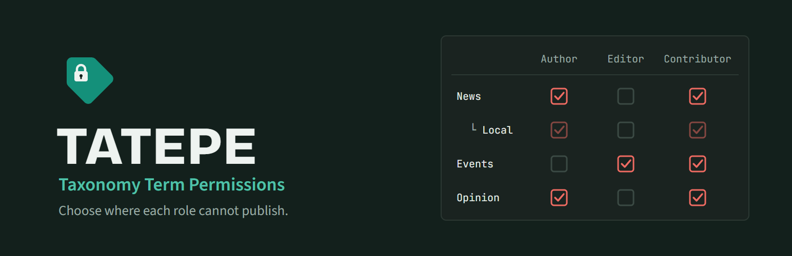

# TATEPE – Taxonomy Term Permissions

Choose the taxonomy terms in which specific roles or users cannot publish.

## Features

- Restrict terms of any taxonomy (categories, tags, custom taxonomies) per role or per single user
- Restricted terms are hidden in the block and classic editor, in the term screens and in the admin filters
- Saves that add a restricted term are refused everywhere: quick edit, bulk edit, REST API, XML-RPC
- Posts assigned to a restricted term are hidden from the admin post lists
- A restricted term also restricts its child terms
- Administrators are never restricted, and the front end is not affected

## Installation

Install it from the WordPress admin (**Plugins → Add New**, search for "TATEPE – Taxonomy Term Permissions") or download it from [WordPress.org](https://wordpress.org/plugins/tatepe-taxonomy-term-permissions/).

## Support

- Questions and help: [WordPress.org support forum](https://wordpress.org/support/plugin/tatepe-taxonomy-term-permissions/)
- Bugs and feature requests: [GitHub issues](https://github.com/milesimarco/tatepe-taxonomy-term-permissions/issues)
- Pull requests are welcome.

If you find this plugin useful, please [leave a review](https://wordpress.org/support/plugin/tatepe-taxonomy-term-permissions/reviews/#new-post) or [buy me a coffee](https://www.paypal.me/milesimarco).

## Author

**Marco Milesi**: [marcomilesi.com](https://marcomilesi.com) · [GitHub](https://github.com/milesimarco) · [WordPress.org](https://profiles.wordpress.org/milmor/)

Other plugins: [wordpress.org/plugins/milmor](https://profiles.wordpress.org/milmor/#content-plugins)

## License

© 2026 Marco Milesi. Released under the [GNU General Public License v2 or later](https://www.gnu.org/licenses/gpl-2.0.html).
